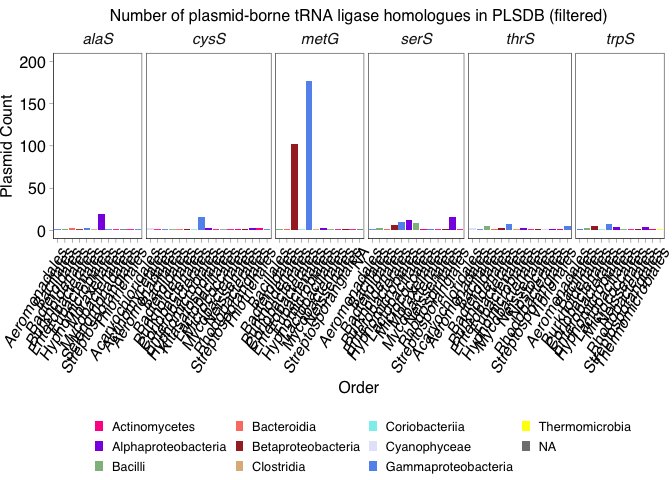
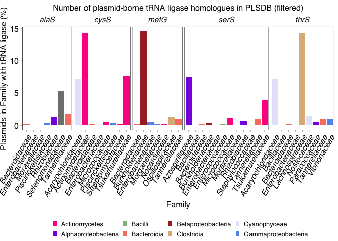
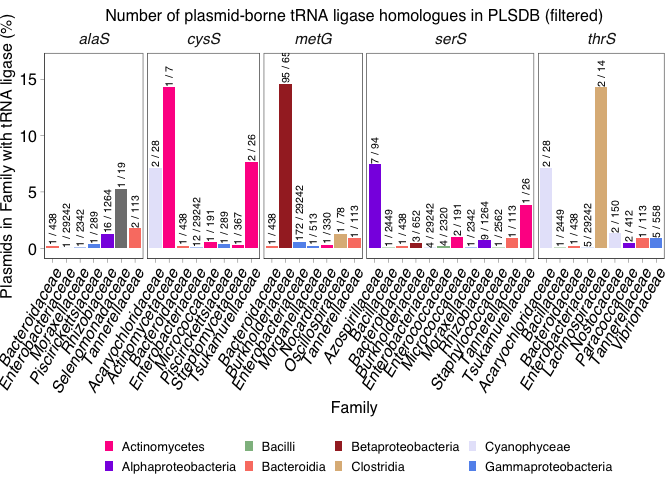
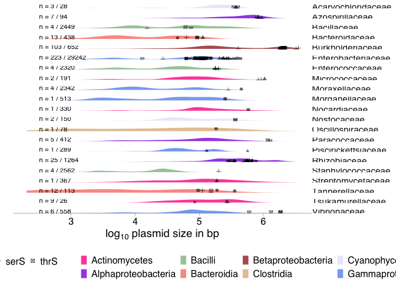

Plasmid-encoded *metG* homologues part 1: plasmid-encoded putative tRNA
ligases
================
JPJ Hall and L Santos
September 2024

## Identifying plasmid-borne tRNA ligase homologues

Genomic epidemiology indicated a plasmid-borne *metG* homologue as a key
genetic factor associated with an epidemic strain of Shigella.

Here, we attempt to address two main questions:

1.  How widespread are plasmid-encoded tRNA ligase homologues in the
    PLSDB database ([Schwartz et
    al. 2022](https://academic.oup.com/nar/article/50/D1/D273/6439675))
    database?
2.  What taxa harbour such plasmids?

### Annotation of PLSDB

The [PLSDB database version 2023_11_23 was
downloaded](https://ccb-microbe.cs.uni-saarland.de/plsdb/plasmids/download/),
and annotated using Bakta ([Schwengers et
al. 2021](https://doi.org/10.1099/mgen.0.000685)) version 1.8.2 with the
‘full’ database v5.0.0.

Annotation was run in batches. Example command:

``` bash
bakta -v --threads 64 --db /pub60/jamesh/db \
  --complete \
  --skip-crispr \
  --locus-tag plsdb_${GROUP} \
  --skip-plot \
  --meta \
  --output ./PLSDB_${GROUP}_bakta \
  --keep-contig-headers plsdb_${GROUP}.fna.gz
```

### Extraction of tRNA ligase homologues from the database

A list of COG categories describing tRNA ligases was downloaded.

``` bash
cat ./1_data/trna_synthetase_COGs.txt
```

The PLSDB database was screened for each COG in turn. Note that *metG*
is COG0143.

``` bash
mkdir ./1_data/all_cog
cat ./1_data/trna_synthetase_COGs.txt | while read COG
do
grep "$COG" $rootdir/PLSDB_*_bakta/plsdb_*.fna.gff3 \
  | sed 's/.*.fna.gff3://g' \
  > ./1_data/all_cog/PLSDB_bakta_${COG}_matches.gff
done
```

Pull all the COG data into a single table.

``` bash
cat ./1_data/all_cog/PLSDB_bakta_COG*_matches.gff > ./1_data/all_cog/PLSDB_bakta_COG_matches.gff
```

### Metadata for PLSDB plasmids

The corresponding PLSDB metadata was downloaded from the database
website.

Load up PLSDB metadata.

``` r
plsdb <- read.table("./1_data/plsdb.tsv", 
                    header = TRUE, 
                    sep = "\t", 
                    fill = TRUE, 
                    quote = "", 
                    na.strings = "") %>%
  filter(!is.na(NUCCORE_UID)) %>%
  rename(Accession = NUCCORE_ACC)
```

Note that preliminary analyses showed there was at least one relevant
sequence in PLSDB that was annotated with genus but not class. Correct
this.

``` r
plsdb <- plsdb %>%
  mutate(TAXONOMY_class = ifelse(NUCCORE_UID == 1563790493, "Mollicutes", TAXONOMY_class))
```

### Analysis of tRNA-ligase-encoding plasmids

Load up functions for extracting information from `.gff` file and load
up the gff file, which contains information on tRNA ligase-encoding CDS.

Note: COG0154 (*gatA*, *iaaH*, *atzF*) amidases were included amongst
the tRNA ligases as gatCAB are used to generate tRNA-Gln by amidating
glutamate after it has been linked to the tRNA ([Sheppard & Söll
2008](https://www.ncbi.nlm.nih.gov/pmc/articles/PMC2366055/)). However,
this COG category are not technically tRNA ligases and so are removed
from downstream analysis.

``` r
source("./func/gff_functions.R")

cog_gff_file <- gffRead("./1_data/all_cog/PLSDB_bakta_COG_matches.gff")
```

    ## Reading ./1_data/all_cog/PLSDB_bakta_COG_matches.gff: found 1393 rows with classes: character, character, character, integer, integer, character, character, character, character

``` r
plasmid_trnalig <- data.frame(Accession = cog_gff_file$seqname,
                      start = cog_gff_file$start,
                      end = cog_gff_file$end,
                      strand = cog_gff_file$strand,
                      ID = getAttributeField(cog_gff_file$attributes, "ID"),
                      product = getAttributeField(cog_gff_file$attributes, "product"),
                      gene = getAttributeField(cog_gff_file$attributes, "gene"),
                      dbxref = getAttributeField(cog_gff_file$attributes, "Dbxref")) %>% 
  mutate(cog = gsub(".*COG:(COG[0-9]{4}),.*", "\\1", dbxref)) %>%
  filter(cog != "COG0154") %>%
  left_join(plsdb, by = "Accession")

(plasmid_trnalig_counts_all <- plasmid_trnalig %>% count(gene, cog)) %>% arrange(-n) %>% kable()
```

| gene  | cog     |   n |
|:------|:--------|----:|
| metG  | COG0143 | 294 |
| serS  | COG0172 |  67 |
| cysS  | COG0215 |  43 |
| thrS  | COG0441 |  41 |
| alaS  | COG0013 |  35 |
| tyrS  | COG0162 |  34 |
| trpS  | COG0180 |  33 |
| argS  | COG0018 |  32 |
| proS  | COG0442 |  30 |
| hisS  | COG0124 |  29 |
| valS  | COG0525 |  28 |
| aspS  | COG0173 |  27 |
| lysS  | COG1190 |  26 |
| ileS  | COG0060 |  25 |
| pheS  | COG0016 |  25 |
| leuS  | COG0495 |  24 |
| gatB  | COG0064 |  20 |
| asnS  | COG0017 |  19 |
| glyQ  | COG0752 |  16 |
| glyS  | COG0751 |  15 |
| gatC  | COG0721 |  14 |
| gRS1  | COG0423 |   3 |
| glyS  | COG0423 |   3 |
| aspS  | COG0017 |   2 |
| metG1 | COG0143 |   2 |
| glyQS | COG0423 |   1 |
| ileS2 | COG0060 |   1 |
| lysS  | COG1384 |   1 |
| lysX  | COG1190 |   1 |
| mshC  | COG0215 |   1 |

``` r
plasmid_trnalig_counts_all %>% summarise(total = sum(n))
```

    ##   total
    ## 1   892

There are 892 tRNA ligases detected in the dataset, but there may be
plasmids with multiple tRNA ligase genes. It is also possible that some
representatives in PLSDB are misclassified chromosomal sequences. To
control for this, identify ‘plasmids’ that have multiple tRNA ligase
genes.

``` r
(multiple_trnalig <- plasmid_trnalig %>% group_by(Accession) %>%
  summarise(size=mean(NUCCORE_Length), n_trnalig = n())) %>% 
  group_by(n_trnalig) %>% summarise(num = n(),
                                    min_length = min(size),
                                    max_length = max(size),
                                    mean_length = mean(size)) %>% kable()
```

| n_trnalig | num | min_length | max_length | mean_length |
|----------:|----:|-----------:|-----------:|------------:|
|         1 | 412 |       3244 |    3525317 |    654810.6 |
|         2 |  49 |      12865 |    2145732 |    451575.6 |
|         3 |  15 |      96317 |    1126962 |    498672.6 |
|         4 |  10 |     148472 |    2048375 |   1387372.0 |
|         5 |   8 |     420355 |    1930550 |   1337376.1 |
|         6 |   5 |     561419 |    2212170 |   1379650.6 |
|         7 |   3 |    1499165 |    2238439 |   1825971.3 |
|        10 |   1 |     899693 |     899693 |    899693.0 |
|        11 |   1 |    2326525 |    2326525 |   2326525.0 |
|        16 |   1 |    4944632 |    4944632 |   4944632.0 |
|        18 |   3 |    2167441 |    3521393 |   2619065.7 |
|        19 |   1 |    3521547 |    3521547 |   3521547.0 |
|        20 |   2 |    3521513 |    4088254 |   3804883.5 |
|        25 |   1 |   11850240 |   11850240 |  11850240.0 |
|        31 |   1 |    5519593 |    5519593 |   5519593.0 |

``` r
multiple_trnalig %>% filter(n_trnalig > 2) %>% summarise(n=n())
```

    ## # A tibble: 1 × 1
    ##       n
    ##   <int>
    ## 1    52

``` r
multiple_trnalig %>% filter(n_trnalig > 2) %>% summarise(n_trnalig = sum(n_trnalig))
```

    ## # A tibble: 1 × 1
    ##   n_trnalig
    ##       <int>
    ## 1       382

There are 52 sequences with \>2 tRNA ligases. Preliminary analyses
indicated the value of removing these from subsequent analyses as
potential chromosomal contaminants.

``` r
multiple_trnalig <- multiple_trnalig %>% filter(n_trnalig > 2) %>% select(Accession) %>% pull()

(plasmid_trnalig_counts <- plasmid_trnalig %>% filter(!(Accession %in% multiple_trnalig)) %>%
    count(gene, cog)) %>% arrange(-n) %>% kable()
```

| gene  | cog     |   n |
|:------|:--------|----:|
| metG  | COG0143 | 276 |
| serS  | COG0172 |  41 |
| alaS  | COG0013 |  23 |
| thrS  | COG0441 |  22 |
| cysS  | COG0215 |  21 |
| trpS  | COG0180 |  11 |
| asnS  | COG0017 |  10 |
| ileS  | COG0060 |  10 |
| leuS  | COG0495 |  10 |
| proS  | COG0442 |  10 |
| argS  | COG0018 |   9 |
| pheS  | COG0016 |   9 |
| valS  | COG0525 |   9 |
| lysS  | COG1190 |   8 |
| aspS  | COG0173 |   6 |
| gatB  | COG0064 |   6 |
| glyQ  | COG0752 |   6 |
| hisS  | COG0124 |   6 |
| tyrS  | COG0162 |   6 |
| glyS  | COG0751 |   5 |
| gatC  | COG0721 |   2 |
| gRS1  | COG0423 |   1 |
| glyQS | COG0423 |   1 |
| glyS  | COG0423 |   1 |
| metG1 | COG0143 |   1 |

``` r
plasmid_trnalig_counts %>% summarise(total = sum(n))
```

    ##   total
    ## 1   510

``` r
plasmid_trnalig_counts %>% filter(!cog == "COG0143") %>%
  summarise(total = sum(n)) # 233 tRNA ligases that are not metG or metG1
```

    ##   total
    ## 1   233

``` r
plasmid_trnalig_counts %>% 
  filter(cog == "COG0143") %>% 
  summarise(total = sum(n))
```

    ##   total
    ## 1   277

277 instances of metG in PLSDB. How many plasmids is this?

``` r
plasmid_trnalig %>% filter(!(Accession %in% multiple_trnalig) & cog == "COG0143") %>%
  group_by(gene, Accession) %>% summarise(n = n()) %>% summarise(n = n())
```

    ## `summarise()` has regrouped the output.
    ## ℹ Summaries were computed grouped by gene and Accession.
    ## ℹ Output is grouped by gene.
    ## ℹ Use `summarise(.groups = "drop_last")` to silence this message.
    ## ℹ Use `summarise(.by = c(gene, Accession))` for per-operation grouping
    ##   (`?dplyr::dplyr_by`) instead.

    ## # A tibble: 2 × 2
    ##   gene      n
    ##   <chr> <int>
    ## 1 metG    273
    ## 2 metG1     1

274 instances.

Plot counts for all genes that have \>10 instances in PLSDB (394
instances, five genes). Set up a colour scheme, and plot.

``` r
class_colours <- c("Actinobacteria" = "deeppink",
                   "Alphaproteobacteria" = "blueviolet",   
                   "Bacilli" = "darkseagreen",
                   "Clostridia" = "burlywood",
                   "Gammaproteobacteria" = "cornflowerblue",   
                   "Planctomycetia" = "darkorange2",
                   "Thermomicrobia" = "yellow",
                   "Actinomycetes" = "deeppink",
                   "Bacteroidia" = "salmon",
                   "Betaproteobacteria" = "brown",
                   "Coriobacteriia" = "darkslategray2",
                   "Cyanophyceae" = "lavender",
                   "Mollicutes" = "darkcyan",
                   "NA" = "grey",
                   "Other" = "grey")

(other_trna_ligases_count <- plasmid_trnalig_counts %>% filter(n > 10) %>%
  left_join(plasmid_trnalig, by=c("gene","cog")) %>%
  ggplot(aes(x=TAXONOMY_order, fill=TAXONOMY_class)) + 
  geom_bar() + 
  scale_fill_manual(values = class_colours, name="") +
  ylim(0, 200) +
  labs(title = "Number of plasmid-borne tRNA ligase homologues in PLSDB (filtered)",
       x = "Order",
       y = "Plasmid Count") +
  facet_grid(.~gene, scale="free", space="free") +
  theme(axis.text.x = element_text(face="italic", angle=60, hjust=1),
        strip.text.x = element_text(face="italic"),
        legend.position = "bottom",
        legend.direction="horizontal"))
```

<!-- -->

``` r
png("./figs/other_trna_ligases_count.png", width=36.5, height=5.2, units="in", res=300)
other_trna_ligases_count
dev.off()
```

    ## quartz_off_screen 
    ##                 2

Key patterns:

- *metG* is found on many Burkholderiales and Enterobacteriales plasmids
- Other tRNA ligases found on plasmids are *alaS*, *cysS*, *serS*,
  *thrS*

What size(s) of plasmids are these found on? Add details to the PLSDB
table.

``` r
plasmid_metG_subset <- filter(plasmid_trnalig, gene == "metG" & !(Accession %in% multiple_trnalig))
plasmid_serS_subset <- filter(plasmid_trnalig, gene == "serS" & !(Accession %in% multiple_trnalig))
plasmid_cysS_subset <- filter(plasmid_trnalig, gene == "cysS" & !(Accession %in% multiple_trnalig))
plasmid_thrS_subset <- filter(plasmid_trnalig, gene == "thrS" & !(Accession %in% multiple_trnalig))
plasmid_alaS_subset <- filter(plasmid_trnalig, gene == "alaS" & !(Accession %in% multiple_trnalig))

plsdb <- plsdb %>%
  mutate(encodes_metG = ifelse(Accession %in% plasmid_metG_subset$Accession, "Y", "N"),
         encodes_serS = ifelse(Accession %in% plasmid_serS_subset$Accession, "Y", "N"),
         encodes_cysS = ifelse(Accession %in% plasmid_cysS_subset$Accession, "Y", "N"),
         encodes_thrS = ifelse(Accession %in% plasmid_thrS_subset$Accession, "Y", "N"),
         encodes_alaS = ifelse(Accession %in% plasmid_alaS_subset$Accession, "Y", "N"),
         encodes_trnalig = ifelse(Accession %in% plasmid_trnalig$Accession, "Y", "N"))
```

How many plasmids in PLSDB have putative tRNA ligases?

``` r
plsdb %>% group_by(encodes_trnalig) %>% count() %>% 
  pivot_wider(values_from = n, names_from = encodes_trnalig) %>%
  mutate(total = Y + N,
         proportion = Y/total,
         percent = proportion * 100) %>% kable()
```

|     N |   Y | total | proportion |   percent |
|------:|----:|------:|-----------:|----------:|
| 59382 | 513 | 59895 |   0.008565 | 0.8564989 |

513 / 59895 plasmids (0.86%) – note that this is before filtering, for
both numerator and denominator.

### Frequency of different tRNA ligase-encoding plasmids per Class

Next, we calculated the number and proportion of plasmids encoding each
of these top tRNA ligases. Here, we filter out sequences that had \>2
tRNA ligases as potential chromosomal contaminants. Identify families
that are predominant hosts of these plasmids to focus on.

``` r
trnalig_families <- plsdb %>% filter(encodes_trnalig == "Y" & !(Accession %in% multiple_trnalig)) %>% 
  select(TAXONOMY_family) %>% pull() %>% unique()

plsdb_subset_trnalig_fam <- filter(plsdb, 
                                   TAXONOMY_family %in% trnalig_families &
                                     !(Accession %in% multiple_trnalig))

(counts_family_trnalig <- plsdb_subset_trnalig_fam %>%
    group_by(TAXONOMY_class, TAXONOMY_family, encodes_trnalig) %>%
    summarise(total = n()) %>%
    pivot_wider(names_from = encodes_trnalig,
                values_from = total,
                values_fill = 0) %>%            
    mutate(totals = N + Y)) %>%                  
  kable()
```

    ## `summarise()` has regrouped the output.
    ## ℹ Summaries were computed grouped by TAXONOMY_class, TAXONOMY_family, and
    ##   encodes_trnalig.
    ## ℹ Output is grouped by TAXONOMY_class and TAXONOMY_family.
    ## ℹ Use `summarise(.groups = "drop_last")` to silence this message.
    ## ℹ Use `summarise(.by = c(TAXONOMY_class, TAXONOMY_family, encodes_trnalig))`
    ##   for per-operation grouping (`?dplyr::dplyr_by`) instead.

| TAXONOMY_class        | TAXONOMY_family     |     N |   Y | totals |
|:----------------------|:--------------------|------:|----:|-------:|
| Actinomycetes         | Actinomycetaceae    |     6 |   1 |      7 |
| Actinomycetes         | Micrococcaceae      |   189 |   2 |    191 |
| Actinomycetes         | Nocardiaceae        |   329 |   1 |    330 |
| Actinomycetes         | Streptomycetaceae   |   366 |   1 |    367 |
| Actinomycetes         | Tsukamurellaceae    |    17 |   9 |     26 |
| Actinomycetes         | NA                  |     1 |   0 |      1 |
| Alphaproteobacteria   | Azospirillaceae     |    87 |   7 |     94 |
| Alphaproteobacteria   | Geminicoccaceae     |     3 |   2 |      5 |
| Alphaproteobacteria   | Methylobacteriaceae |   108 |   1 |    109 |
| Alphaproteobacteria   | Paracoccaceae       |   407 |   5 |    412 |
| Alphaproteobacteria   | Phyllobacteriaceae  |   122 |   2 |    124 |
| Alphaproteobacteria   | Rhizobiaceae        |  1239 |  25 |   1264 |
| Alphaproteobacteria   | NA                  |     7 |   0 |      7 |
| Bacilli               | Bacillaceae         |  2445 |   4 |   2449 |
| Bacilli               | Enterococcaceae     |  2316 |   4 |   2320 |
| Bacilli               | Listeriaceae        |   154 |   1 |    155 |
| Bacilli               | Paenibacillaceae    |   107 |   3 |    110 |
| Bacilli               | Planococcaceae      |    47 |   1 |     48 |
| Bacilli               | Staphylococcaceae   |  2558 |   4 |   2562 |
| Bacilli               | NA                  |    26 |   0 |     26 |
| Bacteroidia           | Bacteroidaceae      |   425 |  13 |    438 |
| Bacteroidia           | Tannerellaceae      |   101 |  12 |    113 |
| Bacteroidia           | NA                  |     9 |   0 |      9 |
| Betaproteobacteria    | Burkholderiaceae    |   549 | 103 |    652 |
| Betaproteobacteria    | Comamonadaceae      |   170 |   1 |    171 |
| Betaproteobacteria    | Sphaerotilaceae     |    10 |   1 |     11 |
| Betaproteobacteria    | NA                  |    12 |   0 |     12 |
| Clostridia            | Lachnospiraceae     |    12 |   2 |     14 |
| Clostridia            | Oscillospiraceae    |    77 |   1 |     78 |
| Clostridia            | NA                  |     1 |   0 |      1 |
| Cyanophyceae          | Acaryochloridaceae  |    25 |   3 |     28 |
| Cyanophyceae          | Nostocaceae         |   148 |   2 |    150 |
| Cyanophyceae          | NA                  |     2 |   0 |      2 |
| Deinococci            | Thermaceae          |    90 |   1 |     91 |
| Deltaproteobacteria   | NA                  |     2 |   0 |      2 |
| Epsilonproteobacteria | Campylobacteraceae  |   377 |   1 |    378 |
| Flavobacteriia        | Weeksellaceae       |    50 |   4 |     54 |
| Fusobacteriia         | Fusobacteriaceae    |    29 |   1 |     30 |
| Gammaproteobacteria   | Enterobacteriaceae  | 29019 | 223 |  29242 |
| Gammaproteobacteria   | Moraxellaceae       |  2338 |   4 |   2342 |
| Gammaproteobacteria   | Morganellaceae      |   512 |   1 |    513 |
| Gammaproteobacteria   | Piscirickettsiaceae |   288 |   1 |    289 |
| Gammaproteobacteria   | Pseudomonadaceae    |   880 |   1 |    881 |
| Gammaproteobacteria   | Vibrionaceae        |   552 |   6 |    558 |
| Gammaproteobacteria   | Xanthomonadaceae    |   526 |   1 |    527 |
| Gammaproteobacteria   | Yersiniaceae        |   710 |   2 |    712 |
| Gammaproteobacteria   | NA                  |     7 |   0 |      7 |
| Mollicutes            | NA                  |     5 |   0 |      5 |
| Negativicutes         | Selenomonadaceae    |    18 |   1 |     19 |
| Spirochaetia          | Leptospiraceae      |   124 |   1 |    125 |
| Thermomicrobia        | Thermomicrobiaceae  |     0 |   1 |      1 |
| NA                    | NA                  |   963 |   1 |    964 |

``` r
plsdb_encodes_metG_counts <- filter(plsdb_subset_trnalig_fam, encodes_metG == "Y") %>%
  group_by(TAXONOMY_family) %>%
  summarise(encodes_metG = n())

plsdb_encodes_alaS_counts <- filter(plsdb_subset_trnalig_fam, encodes_alaS == "Y") %>%
  group_by(TAXONOMY_family) %>%
  summarise(encodes_alaS = n())

plsdb_encodes_cysS_counts <- filter(plsdb_subset_trnalig_fam, encodes_cysS == "Y") %>%
  group_by(TAXONOMY_family) %>%
  summarise(encodes_cysS = n())

plsdb_encodes_serS_counts <- filter(plsdb_subset_trnalig_fam, encodes_serS == "Y") %>%
  group_by(TAXONOMY_family) %>%
  summarise(encodes_serS = n())

plsdb_encodes_thrS_counts <- filter(plsdb_subset_trnalig_fam, encodes_thrS == "Y") %>%
  group_by(TAXONOMY_family) %>%
  summarise(encodes_thrS = n())

(plsdb_encodes_trnalig_counts <- left_join(counts_family_trnalig, 
                                          plsdb_encodes_alaS_counts,
                                          by = "TAXONOMY_family") %>%
  left_join(plsdb_encodes_cysS_counts) %>% left_join(plsdb_encodes_metG_counts) %>%
  left_join(plsdb_encodes_serS_counts) %>% left_join(plsdb_encodes_thrS_counts) %>%
  mutate_if(is.numeric,coalesce,0) %>%
  rename(encodes_trnalig = Y) %>%
    mutate(percent = round(encodes_trnalig * 100 / totals, 2)) %>%
  select(TAXONOMY_class, TAXONOMY_family, encodes_alaS, encodes_cysS, encodes_metG, 
         encodes_serS, encodes_thrS, encodes_trnalig, totals, percent)) %>% kable()
```

    ## Joining with `by = join_by(TAXONOMY_family)`
    ## Joining with `by = join_by(TAXONOMY_family)`
    ## Joining with `by = join_by(TAXONOMY_family)`
    ## Joining with `by = join_by(TAXONOMY_family)`
    ## `mutate_if()` ignored the following grouping variables:

| TAXONOMY_class | TAXONOMY_family | encodes_alaS | encodes_cysS | encodes_metG | encodes_serS | encodes_thrS | encodes_trnalig | totals | percent |
|:---|:---|---:|---:|---:|---:|---:|---:|---:|---:|
| Actinomycetes | Actinomycetaceae | 0 | 1 | 0 | 0 | 0 | 1 | 7 | 14.29 |
| Actinomycetes | Micrococcaceae | 0 | 1 | 0 | 2 | 0 | 2 | 191 | 1.05 |
| Actinomycetes | Nocardiaceae | 0 | 0 | 1 | 0 | 0 | 1 | 330 | 0.30 |
| Actinomycetes | Streptomycetaceae | 0 | 1 | 0 | 0 | 0 | 1 | 367 | 0.27 |
| Actinomycetes | Tsukamurellaceae | 0 | 2 | 0 | 1 | 0 | 9 | 26 | 34.62 |
| Actinomycetes | NA | 0 | 0 | 1 | 0 | 0 | 0 | 1 | 0.00 |
| Alphaproteobacteria | Azospirillaceae | 0 | 0 | 0 | 7 | 0 | 7 | 94 | 7.45 |
| Alphaproteobacteria | Geminicoccaceae | 0 | 0 | 0 | 1 | 0 | 2 | 5 | 40.00 |
| Alphaproteobacteria | Methylobacteriaceae | 0 | 0 | 0 | 0 | 0 | 1 | 109 | 0.92 |
| Alphaproteobacteria | Paracoccaceae | 0 | 0 | 0 | 0 | 2 | 5 | 412 | 1.21 |
| Alphaproteobacteria | Phyllobacteriaceae | 0 | 0 | 0 | 0 | 0 | 2 | 124 | 1.61 |
| Alphaproteobacteria | Rhizobiaceae | 16 | 0 | 0 | 9 | 0 | 25 | 1264 | 1.98 |
| Alphaproteobacteria | NA | 0 | 0 | 1 | 0 | 0 | 0 | 7 | 0.00 |
| Bacilli | Bacillaceae | 0 | 0 | 0 | 1 | 1 | 4 | 2449 | 0.16 |
| Bacilli | Enterococcaceae | 0 | 0 | 0 | 4 | 0 | 4 | 2320 | 0.17 |
| Bacilli | Listeriaceae | 0 | 0 | 0 | 0 | 0 | 1 | 155 | 0.65 |
| Bacilli | Paenibacillaceae | 0 | 0 | 0 | 0 | 0 | 3 | 110 | 2.73 |
| Bacilli | Planococcaceae | 0 | 0 | 0 | 0 | 0 | 1 | 48 | 2.08 |
| Bacilli | Staphylococcaceae | 0 | 0 | 0 | 1 | 0 | 4 | 2562 | 0.16 |
| Bacilli | NA | 0 | 0 | 1 | 0 | 0 | 0 | 26 | 0.00 |
| Bacteroidia | Bacteroidaceae | 1 | 1 | 1 | 1 | 1 | 13 | 438 | 2.97 |
| Bacteroidia | Tannerellaceae | 2 | 0 | 1 | 1 | 1 | 12 | 113 | 10.62 |
| Bacteroidia | NA | 0 | 0 | 1 | 0 | 0 | 0 | 9 | 0.00 |
| Betaproteobacteria | Burkholderiaceae | 0 | 0 | 95 | 3 | 0 | 103 | 652 | 15.80 |
| Betaproteobacteria | Comamonadaceae | 0 | 0 | 0 | 0 | 0 | 1 | 171 | 0.58 |
| Betaproteobacteria | Sphaerotilaceae | 0 | 0 | 0 | 0 | 0 | 1 | 11 | 9.09 |
| Betaproteobacteria | NA | 0 | 0 | 1 | 0 | 0 | 0 | 12 | 0.00 |
| Clostridia | Lachnospiraceae | 0 | 0 | 0 | 0 | 2 | 2 | 14 | 14.29 |
| Clostridia | Oscillospiraceae | 0 | 0 | 1 | 0 | 0 | 1 | 78 | 1.28 |
| Clostridia | NA | 0 | 0 | 1 | 0 | 0 | 0 | 1 | 0.00 |
| Cyanophyceae | Acaryochloridaceae | 0 | 2 | 0 | 0 | 2 | 3 | 28 | 10.71 |
| Cyanophyceae | Nostocaceae | 0 | 0 | 0 | 0 | 2 | 2 | 150 | 1.33 |
| Cyanophyceae | NA | 0 | 0 | 1 | 0 | 0 | 0 | 2 | 0.00 |
| Deinococci | Thermaceae | 0 | 0 | 0 | 0 | 0 | 1 | 91 | 1.10 |
| Deltaproteobacteria | NA | 0 | 0 | 1 | 0 | 0 | 0 | 2 | 0.00 |
| Epsilonproteobacteria | Campylobacteraceae | 0 | 0 | 0 | 0 | 0 | 1 | 378 | 0.26 |
| Flavobacteriia | Weeksellaceae | 0 | 0 | 0 | 0 | 0 | 4 | 54 | 7.41 |
| Fusobacteriia | Fusobacteriaceae | 0 | 0 | 0 | 0 | 0 | 1 | 30 | 3.33 |
| Gammaproteobacteria | Enterobacteriaceae | 1 | 12 | 172 | 4 | 5 | 223 | 29242 | 0.76 |
| Gammaproteobacteria | Moraxellaceae | 1 | 0 | 0 | 1 | 0 | 4 | 2342 | 0.17 |
| Gammaproteobacteria | Morganellaceae | 0 | 0 | 1 | 0 | 0 | 1 | 513 | 0.19 |
| Gammaproteobacteria | Piscirickettsiaceae | 1 | 1 | 0 | 0 | 0 | 1 | 289 | 0.35 |
| Gammaproteobacteria | Pseudomonadaceae | 0 | 0 | 0 | 0 | 0 | 1 | 881 | 0.11 |
| Gammaproteobacteria | Vibrionaceae | 0 | 0 | 0 | 0 | 5 | 6 | 558 | 1.08 |
| Gammaproteobacteria | Xanthomonadaceae | 0 | 0 | 0 | 0 | 0 | 1 | 527 | 0.19 |
| Gammaproteobacteria | Yersiniaceae | 0 | 0 | 0 | 0 | 0 | 2 | 712 | 0.28 |
| Gammaproteobacteria | NA | 0 | 0 | 1 | 0 | 0 | 0 | 7 | 0.00 |
| Mollicutes | NA | 0 | 0 | 1 | 0 | 0 | 0 | 5 | 0.00 |
| Negativicutes | Selenomonadaceae | 1 | 0 | 0 | 0 | 0 | 1 | 19 | 5.26 |
| Spirochaetia | Leptospiraceae | 0 | 0 | 0 | 0 | 0 | 1 | 125 | 0.80 |
| Thermomicrobia | Thermomicrobiaceae | 0 | 0 | 0 | 0 | 0 | 1 | 1 | 100.00 |
| NA | NA | 0 | 0 | 1 | 0 | 0 | 1 | 964 | 0.10 |

Filter for families with \>1 instances.

``` r
(plsdb_encodes_trnalig_counts_long <- plsdb_encodes_trnalig_counts %>%
  select(-totals, -percent) %>% 
  pivot_longer(cols = -c(TAXONOMY_family, TAXONOMY_class), names_to = "encodes", values_to = "count") %>%
  filter(count > 1)) %>% arrange(encodes) %>% kable()
```

| TAXONOMY_class      | TAXONOMY_family    | encodes         | count |
|:--------------------|:-------------------|:----------------|------:|
| Alphaproteobacteria | Rhizobiaceae       | encodes_alaS    |    16 |
| Bacteroidia         | Tannerellaceae     | encodes_alaS    |     2 |
| Actinomycetes       | Tsukamurellaceae   | encodes_cysS    |     2 |
| Cyanophyceae        | Acaryochloridaceae | encodes_cysS    |     2 |
| Gammaproteobacteria | Enterobacteriaceae | encodes_cysS    |    12 |
| Betaproteobacteria  | Burkholderiaceae   | encodes_metG    |    95 |
| Gammaproteobacteria | Enterobacteriaceae | encodes_metG    |   172 |
| Actinomycetes       | Micrococcaceae     | encodes_serS    |     2 |
| Alphaproteobacteria | Azospirillaceae    | encodes_serS    |     7 |
| Alphaproteobacteria | Rhizobiaceae       | encodes_serS    |     9 |
| Bacilli             | Enterococcaceae    | encodes_serS    |     4 |
| Betaproteobacteria  | Burkholderiaceae   | encodes_serS    |     3 |
| Gammaproteobacteria | Enterobacteriaceae | encodes_serS    |     4 |
| Alphaproteobacteria | Paracoccaceae      | encodes_thrS    |     2 |
| Clostridia          | Lachnospiraceae    | encodes_thrS    |     2 |
| Cyanophyceae        | Acaryochloridaceae | encodes_thrS    |     2 |
| Cyanophyceae        | Nostocaceae        | encodes_thrS    |     2 |
| Gammaproteobacteria | Enterobacteriaceae | encodes_thrS    |     5 |
| Gammaproteobacteria | Vibrionaceae       | encodes_thrS    |     5 |
| Actinomycetes       | Micrococcaceae     | encodes_trnalig |     2 |
| Actinomycetes       | Tsukamurellaceae   | encodes_trnalig |     9 |
| Alphaproteobacteria | Azospirillaceae    | encodes_trnalig |     7 |
| Alphaproteobacteria | Geminicoccaceae    | encodes_trnalig |     2 |
| Alphaproteobacteria | Paracoccaceae      | encodes_trnalig |     5 |
| Alphaproteobacteria | Phyllobacteriaceae | encodes_trnalig |     2 |
| Alphaproteobacteria | Rhizobiaceae       | encodes_trnalig |    25 |
| Bacilli             | Bacillaceae        | encodes_trnalig |     4 |
| Bacilli             | Enterococcaceae    | encodes_trnalig |     4 |
| Bacilli             | Paenibacillaceae   | encodes_trnalig |     3 |
| Bacilli             | Staphylococcaceae  | encodes_trnalig |     4 |
| Bacteroidia         | Bacteroidaceae     | encodes_trnalig |    13 |
| Bacteroidia         | Tannerellaceae     | encodes_trnalig |    12 |
| Betaproteobacteria  | Burkholderiaceae   | encodes_trnalig |   103 |
| Clostridia          | Lachnospiraceae    | encodes_trnalig |     2 |
| Cyanophyceae        | Acaryochloridaceae | encodes_trnalig |     3 |
| Cyanophyceae        | Nostocaceae        | encodes_trnalig |     2 |
| Flavobacteriia      | Weeksellaceae      | encodes_trnalig |     4 |
| Gammaproteobacteria | Enterobacteriaceae | encodes_trnalig |   223 |
| Gammaproteobacteria | Moraxellaceae      | encodes_trnalig |     4 |
| Gammaproteobacteria | Vibrionaceae       | encodes_trnalig |     6 |
| Gammaproteobacteria | Yersiniaceae       | encodes_trnalig |     2 |

What families have *metG*?

``` r
plsdb_encodes_trnalig_counts_long %>% filter(encodes == "encodes_metG" & count > 0) 
```

    ## # A tibble: 2 × 4
    ## # Groups:   TAXONOMY_class, TAXONOMY_family [2]
    ##   TAXONOMY_class      TAXONOMY_family    encodes      count
    ##   <chr>               <chr>              <chr>        <dbl>
    ## 1 Betaproteobacteria  Burkholderiaceae   encodes_metG    95
    ## 2 Gammaproteobacteria Enterobacteriaceae encodes_metG   172

Excepting a few singletons, it is found in Burkholderiaceae and
Enterobacteriaceae.

Filter table for families with \>5 plasmids, calculate percentages,
plot. Note that NAs need to be removed, or fractions cannot be properly
calculated.

``` r
plsdb_encodes_trnalig_percent <- plsdb_encodes_trnalig_counts %>% 
  filter(totals > 5) %>%
  select(TAXONOMY_family, starts_with("encodes_"), totals) %>%
  pivot_longer(cols = starts_with("encodes"),
               names_to = "trna_ligase",
               values_to = "count") %>%
  filter(count > 0) %>%
  mutate(trna_ligase = sub("encodes_", "", trna_ligase),
         percent = count * 100 / totals) %>%
  filter(percent > 0)
```

    ## Adding missing grouping variables: `TAXONOMY_class`

``` r
plsdb_encodes_trnalig_percent %>% 
  filter(trna_ligase == "trnalig" & !(is.na(TAXONOMY_family))) %>% 
  ungroup() %>% summarise(families = length(unique(TAXONOMY_family)), 
                          total_trnalig = sum(count), total_plasmids = sum(totals)) 
```

    ## # A tibble: 1 × 3
    ##   families total_trnalig total_plasmids
    ##      <int>         <dbl>          <dbl>
    ## 1       39           457          47984

``` r
# 458 / 48948 plasmids, 40 families
# if NA is removed, 457 / 47984 plasmids, 39 families

plsdb_encodes_trnalig_percent %>% 
  filter(trna_ligase == "metG" & !is.na(TAXONOMY_family)) %>% 
  group_by(trna_ligase) %>% summarise(n = n())
```

    ## # A tibble: 1 × 2
    ##   trna_ligase     n
    ##   <chr>       <int>
    ## 1 metG            7

``` r
# 13 families, 7 if NA is removed

(other_trna_ligases_percent <- plsdb_encodes_trnalig_percent %>% 
  filter(!is.na(TAXONOMY_family) & trna_ligase != "trnalig") %>%
  ggplot(aes(x=TAXONOMY_family, y=percent, fill=TAXONOMY_class)) + 
  geom_bar(stat="identity") + 
  scale_fill_manual(values = class_colours, name="") +
  labs(title = "Number of plasmid-borne tRNA ligase homologues in PLSDB (filtered)",
       x = "Family",
       y = "Plasmids in Family with tRNA ligase (%)") +
  facet_grid(.~trna_ligase, scale="free", space="free") +
  theme(axis.text.x = element_text(face="italic", angle=60, hjust=1),
        strip.text.x = element_text(face="italic"),
        legend.position = "bottom",
        legend.direction="horizontal"))
```

<!-- -->

Annotate this figure with details on total number of plasmids per
Family.

``` r
(other_trna_ligases_percent_annot <- other_trna_ligases_percent +
   scale_y_continuous(limits=c(-0.1, 16.5)) +
  geom_text(aes(label=paste(count, " / ", totals, sep=""), y=percent+0.1), 
            hjust=0, vjust=0.5, size=2.8, angle=90))
```

<!-- -->

``` r
png("./figs/other_trnaligases_percent.png", height=6.2, width=8.8, units="in", res=300)
other_trna_ligases_percent_annot + ggtitle("")
dev.off()
```

    ## quartz_off_screen 
    ##                 2

Note that this plot is filtered to remove plasmids with \>2 predicted
tRNA ligases, and to remove families with \<6 plasmids, and families
annotated as NA.

### Output results for subsequent analyses

Next, we focus on exploring *metG*-encoding plasmids. Output a list of
plasmids with \>2 tRNA ligases to filter out putative chromosomal
contamination in the subsequent analysis, and output a filtered list of
the *metG*-encoding plasmids to explore.

``` r
write.table(multiple_trnalig, "./1_data/multiple_trnalig.txt",
            quote=FALSE, col.names=FALSE, row.names=FALSE)

filter(plsdb_subset_trnalig_fam, encodes_metG == "Y") %>% select(NUCCORE_UID) %>% 
  pull() %>% write.table(file = "./1_data/metG_plsdb_uid.txt", quote=FALSE, col.names=FALSE, row.names=FALSE)
```

### Joy plot

To get a feel for the size of tRNA ligase-encoding plasmids, indicate
the size of the plasmids encoding the top five tRNA ligases on a size
distribution. Here, plot only Families with \>20 plasmids in PLSDB to
ensure a proper distribution can be drawn, and plot only for families
with more than two plasmids with these top five tRNA ligases.

``` r
family_count_20 <- filter(counts_family_trnalig, totals > 20 & !is.na(TAXONOMY_family))

plsdb_subset_fam_20_trnalig_annot <- filter(plasmid_trnalig, !(Accession %in% multiple_trnalig) & 
                                              TAXONOMY_family %in% family_count_20$TAXONOMY_family &
                                              gene %in% c("alaS","cysS","metG","serS","thrS"))

plsdb_subset_fam_20_trnalig <- filter(plsdb_subset_trnalig_fam, 
                                      TAXONOMY_family %in% plsdb_subset_fam_20_trnalig_annot$TAXONOMY_family)

family_count_20 <- filter(family_count_20, 
                          TAXONOMY_family %in% plsdb_subset_fam_20_trnalig_annot$TAXONOMY_family)

family_count_20 %>% ungroup() %>% summarise(total_positive = sum(Y))
```

    ## # A tibble: 1 × 1
    ##   total_positive
    ##            <int>
    ## 1            431

``` r
jitt <- position_jitter(width=NULL, height=0.2)

(trnalig_joy_plot_fam <- ggplot(plsdb_subset_fam_20_trnalig, aes(x = log10(NUCCORE_Length))) +
  geom_density(linewidth = 0, aes(fill = TAXONOMY_class), alpha = 0.8) +
   geom_text(data = family_count_20,
             aes(x = 2.5, y = 0,
                 label = paste("n = ", Y, " / ", totals, sep = "")),
             hjust = 0, vjust = 0, size = 3) +
  scale_fill_manual(values = class_colours, name = "") +
  geom_point(data = plsdb_subset_fam_20_trnalig_annot, position = jitt,
             aes(y = 0.1, shape=gene), alpha = 0.6, colour = "black") + 
  facet_grid(TAXONOMY_family ~ ., scales = "free_y") +
  labs(x = expression(paste("log"[10], " plasmid size in bp")), y = "",
       shape="") +
  theme(
    axis.line.y = element_blank(),
    axis.text.y = element_blank(),
    panel.border = element_blank(), 
    axis.ticks.y = element_blank(),
    panel.grid.major = element_blank(),
    panel.grid.minor = element_blank(),
    legend.position = "bottom",
    legend.text = element_text(size = 12),
    legend.title = element_text(size = 14),         
    axis.title.x = element_text(size = 14),         
    axis.title.y = element_text(size = 14),         
    axis.text.x = element_text(size = 12),          
    strip.text.y = element_text(angle = 0, hjust = 0)
  ))
```

<!-- -->

``` r
png("./figs/joy_plot.png", height=10.2, width=8.4, units="in", res=300)
trnalig_joy_plot_fam + ggtitle("") + theme(legend.position="bottom", legend.direction="vertical")
dev.off()
```

    ## quartz_off_screen 
    ##                 2

This shows that tRNA ligase-encoding plasmids tend to be relatively
large for their corresponding family.

Make a big table of the data used.

``` r
families_filtered <- plsdb_encodes_trnalig_counts %>% 
  filter(totals > 5) %>% select(TAXONOMY_family) %>% left_join(plsdb) %>% 
  select(Accession) %>% pull()
```

    ## Adding missing grouping variables: `TAXONOMY_class`
    ## Joining with `by = join_by(TAXONOMY_class, TAXONOMY_family)`
    ## Adding missing grouping variables: `TAXONOMY_class`, `TAXONOMY_family`

``` r
plasmid_trnalig %>% select(Accession, 
                           TAXONOMY_class, TAXONOMY_order, TAXONOMY_family, TAXONOMY_genus, TAXONOMY_species,
                           NUCCORE_Length, gene, cog) %>%
  filter(cog != "COG0154") %>% 
  mutate(gene_cog = paste(gene, " (", cog, ")", sep="")) %>%
  group_by(Accession,
           TAXONOMY_class, TAXONOMY_order, TAXONOMY_family, 
           TAXONOMY_genus, TAXONOMY_species,NUCCORE_Length) %>%
  reframe(Genes = str_c(gene_cog, collapse = ", ")) %>%
  mutate(`Filtered (multiple)` = ifelse(Accession %in% multiple_trnalig, "Y", ""),
         `Filtered (insufficient in Family)` = ifelse(Accession %in% families_filtered, "", "Y")) %>%
  rename(Class = TAXONOMY_class,
         Order = TAXONOMY_order,
         Family = TAXONOMY_family,
         Genus = TAXONOMY_genus,
         Species = TAXONOMY_species,
         `Length (bp)` = NUCCORE_Length) %>%
  write.table("./1_data/supplementary_table_accessions.tsv", row.names=FALSE, sep="\t", quote=FALSE)
```

------------------------------------------------------------------------

**[On to analysis of metG-encoding plasmids.](2_PLSDB_metG.md)**

**[Back to index.](../README.md)**
