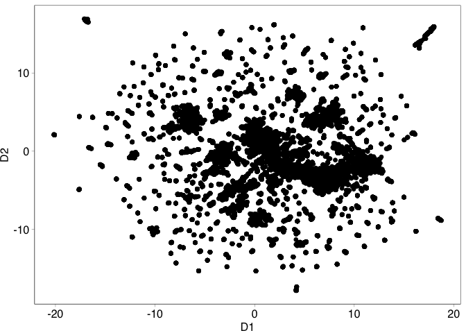
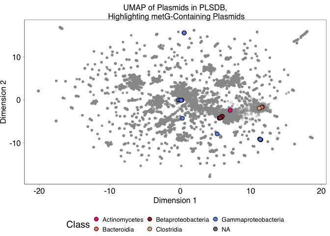
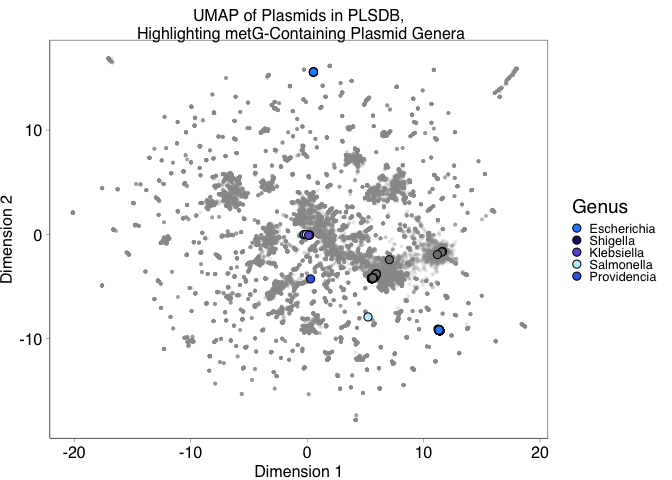
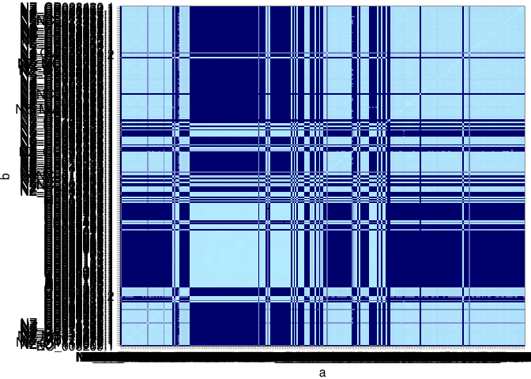
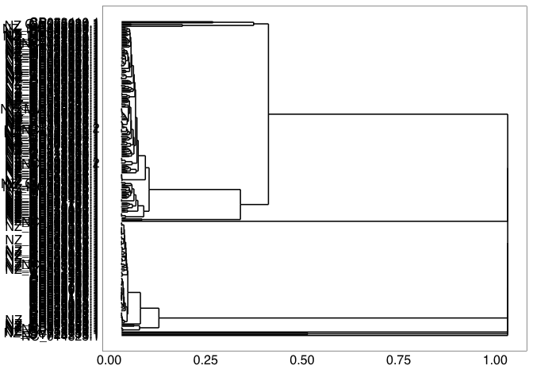
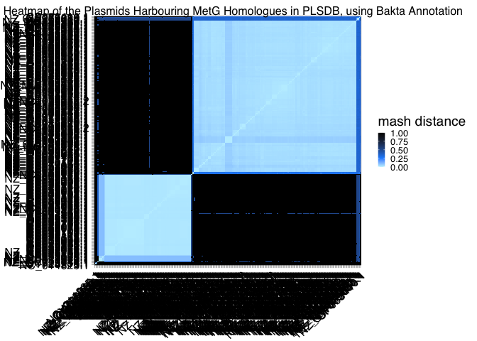
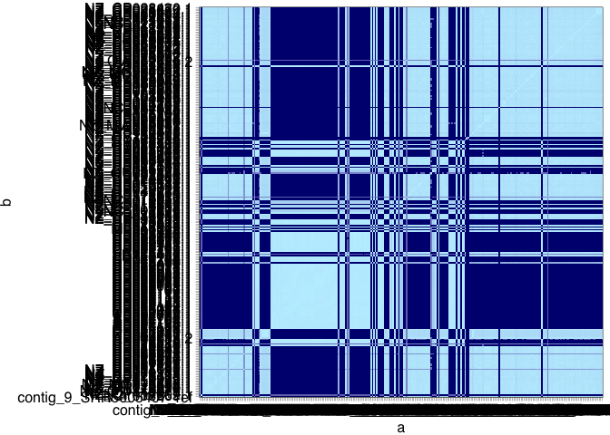
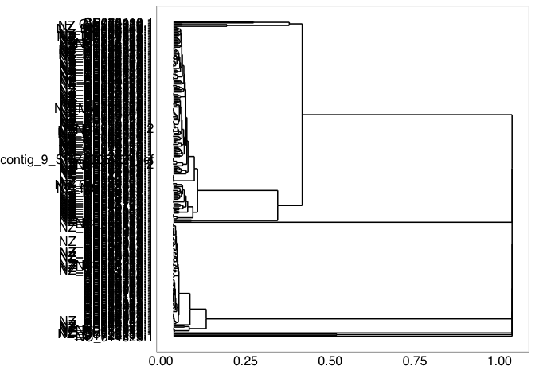
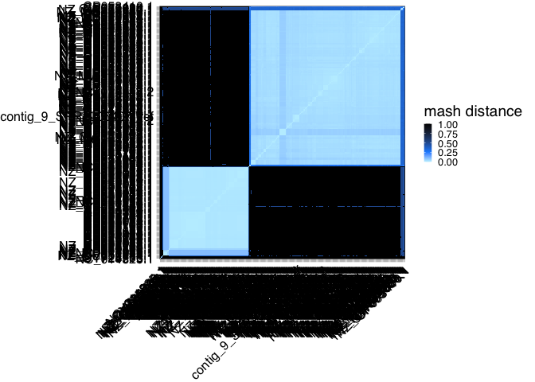
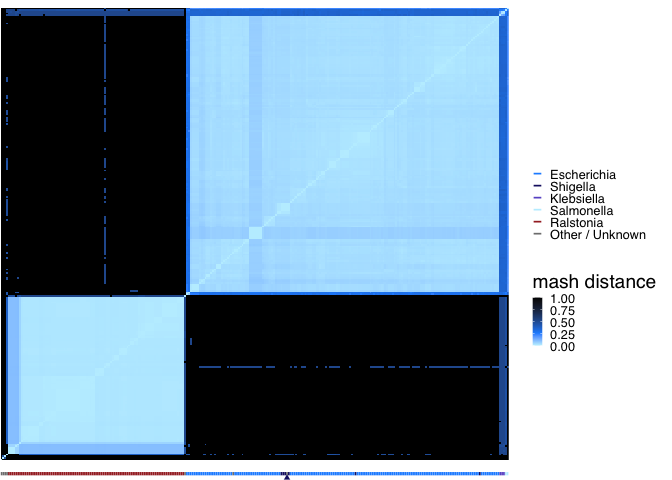

Plasmid encoded *metG* homologues: plasmids
================
JPJ Hall and L Santos
September 2024

## Comparison of plasmids encoding *metG*

We wanted to look further at the features of plasmids encoding *metG*.

We attempted to address 2 questions:

1.  What is the diversity of *metG*-encoding plasmids, compared with
    other plasmids across PLSDB?
2.  What are the similarities of *metG*-encoding plasmids to one
    another?

### Comparing features of *metG*-encoding plasmids

#### Plasmid typing of *metG*-encoding plasmids

Use PLSDB annotations to examine some of the overall features of the
*metG* encoding plasmids.

Read in the filtered data that contains only plasmids that were from
genera with \>9 plasmids in PLSDB and summarise pMLST and PlasmidFinder
results.

``` r
metg_plasmids_uid <- read.table("./1_data/metG_plsdb_uid.txt", col.names="NUCCORE_UID")

plsdb <- read.table("./1_data/plsdb.tsv", 
                    header = TRUE, 
                    sep = "\t", 
                    fill = TRUE, 
                    quote = "", 
                    na.strings = "") %>%
  filter(!is.na(NUCCORE_UID)) %>%
  mutate(filtered_metg = ifelse(NUCCORE_UID %in% metg_plasmids_uid$NUCCORE_UID, "Y", "N"))

metg_plasmids <- plsdb %>%
  right_join(metg_plasmids_uid, by="NUCCORE_UID")

metg_plasmids %>% 
  group_by(pmlst) %>%
  summarise(n = n(),
            min_size = min(NUCCORE_Length)/1000,
            max_size = max(NUCCORE_Length)/1000,
            mean_size = mean(NUCCORE_Length)/1000) %>%
  kable()
```

| pmlst | n | min_size | max_size | mean_size |
|:---|---:|---:|---:|---:|
| IncF RST(F-:A-:B-):FIA(-);FIB(-);FIC(-);FII(-);FIIK(-);FIIS(-);FIIY(-) | 165 | 62.256 | 128.323 | 108.664 |
| IncF RST(F-:A-:B-):FIA(-);FIB(~52);FIC(-);FII(-);FIIK(-);FIIS(-);FIIY(-) | 1 | 152.530 | 152.530 | 152.530 |
| NA | 107 | 91.552 | 2210.741 | 1851.052 |

Most of the plasmids were IncF type, but of indefinite subtype (“F-”)
and lacking the FIA and FIB replicons. Thirty had untypable replicons
(NA).

How does this look by taxon?

``` r
metg_plasmids %>% 
  group_by(TAXONOMY_class, TAXONOMY_family, pmlst) %>%
  summarise(n=n()) %>% kable()
```

    ## `summarise()` has regrouped the output.
    ## ℹ Summaries were computed grouped by TAXONOMY_class, TAXONOMY_family, and
    ##   pmlst.
    ## ℹ Output is grouped by TAXONOMY_class and TAXONOMY_family.
    ## ℹ Use `summarise(.groups = "drop_last")` to silence this message.
    ## ℹ Use `summarise(.by = c(TAXONOMY_class, TAXONOMY_family, pmlst))` for
    ##   per-operation grouping (`?dplyr::dplyr_by`) instead.

| TAXONOMY_class | TAXONOMY_family | pmlst | n |
|:---|:---|:---|---:|
| Actinomycetes | Nocardiaceae | NA | 1 |
| Bacteroidia | Bacteroidaceae | NA | 1 |
| Bacteroidia | Tannerellaceae | NA | 1 |
| Betaproteobacteria | Burkholderiaceae | NA | 95 |
| Clostridia | Oscillospiraceae | NA | 1 |
| Gammaproteobacteria | Enterobacteriaceae | IncF RST(F-:A-:B-):FIA(-);FIB(-);FIC(-);FII(-);FIIK(-);FIIS(-);FIIY(-) | 164 |
| Gammaproteobacteria | Enterobacteriaceae | IncF RST(F-:A-:B-):FIA(-);FIB(~52);FIC(-);FII(-);FIIK(-);FIIS(-);FIIY(-) | 1 |
| Gammaproteobacteria | Enterobacteriaceae | NA | 7 |
| Gammaproteobacteria | Morganellaceae | NA | 1 |
| NA | NA | IncF RST(F-:A-:B-):FIA(-);FIB(-);FIC(-);FII(-);FIIK(-);FIIS(-);FIIY(-) | 1 |

Non-Gammaproteobacterial plasmids were not typable, excepting one ‘NA’
plasmid which on futher inspection came from a non-cultured bacterium.
There were a handful of non-typable Gammaproteobacterial plasmids.

How does this compare with the PlasmidFinder outputs?

``` r
metg_plasmids %>% 
  group_by(plasmidfinder) %>%
  summarise(n = n(),
            min_size = min(NUCCORE_Length)/1000,
            max_size = max(NUCCORE_Length)/1000,
            mean_size = mean(NUCCORE_Length)/1000) %>%
  kable()
```

| plasmidfinder | n | min_size | max_size | mean_size |
|:---|---:|---:|---:|---:|
| IncFIB(AP001918)\_1, AP001918, \|IncFIB(H89-PhagePlasmid)\_1, HG530657, | 1 | 152.530 | 152.530 | 152.5300 |
| IncFIB(H89-PhagePlasmid)\_1, HG530657, | 106 | 62.256 | 128.323 | 107.5292 |
| IncFIB(pHCM2)\_1, AL513384, | 6 | 94.797 | 113.610 | 103.8340 |
| IncFIB(pLF82-PhagePlasmid)\_1, CU638872, | 53 | 101.340 | 126.289 | 111.4804 |
| NA | 107 | 91.552 | 2210.741 | 1851.0521 |

Here we have a bit more definition: the *metG* encoding plasmids are
typed by PlasmidFinder as IncFIB, and there is indication that they are
related to phage plasmids.

``` r
metg_plasmids %>% 
  group_by(TAXONOMY_class, TAXONOMY_family, plasmidfinder) %>%
  summarise(n=n()) %>% kable()
```

    ## `summarise()` has regrouped the output.
    ## ℹ Summaries were computed grouped by TAXONOMY_class, TAXONOMY_family, and
    ##   plasmidfinder.
    ## ℹ Output is grouped by TAXONOMY_class and TAXONOMY_family.
    ## ℹ Use `summarise(.groups = "drop_last")` to silence this message.
    ## ℹ Use `summarise(.by = c(TAXONOMY_class, TAXONOMY_family, plasmidfinder))` for
    ##   per-operation grouping (`?dplyr::dplyr_by`) instead.

| TAXONOMY_class | TAXONOMY_family | plasmidfinder | n |
|:---|:---|:---|---:|
| Actinomycetes | Nocardiaceae | NA | 1 |
| Bacteroidia | Bacteroidaceae | NA | 1 |
| Bacteroidia | Tannerellaceae | NA | 1 |
| Betaproteobacteria | Burkholderiaceae | NA | 95 |
| Clostridia | Oscillospiraceae | NA | 1 |
| Gammaproteobacteria | Enterobacteriaceae | IncFIB(AP001918)\_1, AP001918, \|IncFIB(H89-PhagePlasmid)\_1, HG530657, | 1 |
| Gammaproteobacteria | Enterobacteriaceae | IncFIB(H89-PhagePlasmid)\_1, HG530657, | 105 |
| Gammaproteobacteria | Enterobacteriaceae | IncFIB(pHCM2)\_1, AL513384, | 6 |
| Gammaproteobacteria | Enterobacteriaceae | IncFIB(pLF82-PhagePlasmid)\_1, CU638872, | 53 |
| Gammaproteobacteria | Enterobacteriaceae | NA | 7 |
| Gammaproteobacteria | Morganellaceae | NA | 1 |
| NA | NA | IncFIB(H89-PhagePlasmid)\_1, HG530657, | 1 |

``` r
metg_plasmids %>%
  group_by(plasmidfinder) %>%
  summarise(n=n()) %>% arrange(-n) %>% kable()
```

| plasmidfinder | n |
|:---|---:|
| NA | 107 |
| IncFIB(H89-PhagePlasmid)\_1, HG530657, | 106 |
| IncFIB(pLF82-PhagePlasmid)\_1, CU638872, | 53 |
| IncFIB(pHCM2)\_1, AL513384, | 6 |
| IncFIB(AP001918)\_1, AP001918, \|IncFIB(H89-PhagePlasmid)\_1, HG530657, | 1 |

``` r
metg_plasmids %>% filter(TAXONOMY_family == "Enterobacteriaceae") %>% nrow()
```

    ## [1] 172

``` r
metg_plasmids %>% filter(TAXONOMY_family == "Burkholderiaceae") %>% nrow()
```

    ## [1] 95

``` r
metg_plasmids %>% filter(TAXONOMY_family == "Enterobacteriaceae") %>%
  group_by(TAXONOMY_genus, plasmidfinder) %>% summarise(n=n()) %>% arrange(TAXONOMY_genus, -n) %>% kable()
```

    ## `summarise()` has regrouped the output.
    ## ℹ Summaries were computed grouped by TAXONOMY_genus and plasmidfinder.
    ## ℹ Output is grouped by TAXONOMY_genus.
    ## ℹ Use `summarise(.groups = "drop_last")` to silence this message.
    ## ℹ Use `summarise(.by = c(TAXONOMY_genus, plasmidfinder))` for per-operation
    ##   grouping (`?dplyr::dplyr_by`) instead.

| TAXONOMY_genus | plasmidfinder | n |
|:---|:---|---:|
| Escherichia | IncFIB(H89-PhagePlasmid)\_1, HG530657, | 100 |
| Escherichia | IncFIB(pLF82-PhagePlasmid)\_1, CU638872, | 52 |
| Escherichia | IncFIB(pHCM2)\_1, AL513384, | 6 |
| Escherichia | NA | 2 |
| Escherichia | IncFIB(AP001918)\_1, AP001918, \|IncFIB(H89-PhagePlasmid)\_1, HG530657, | 1 |
| Klebsiella | NA | 3 |
| Salmonella | NA | 2 |
| Shigella | IncFIB(H89-PhagePlasmid)\_1, HG530657, | 5 |
| Shigella | IncFIB(pLF82-PhagePlasmid)\_1, CU638872, | 1 |

The predominant type is IncFIB(H89-PhagePlasmid)\_1, HG530657. This
relates to type plasmid NC_023916.1 “Escherichia coli H89 plasmid
pECOH89” in Genbank ([Falgenhauer et
al. 2014](https://doi.org/10.1128/genomea.00356-14)), which was
identified in our search as harbouring *metG*.

The second most common was IncFIB(pLF82-PhagePlasmid)\_1, CU638872. This
relates to type plasmid NC_011917.1 “Escherichia coli LF82 plasmid
unnamed” ([Miquel et
al. 2010](https://dx.doi.org/10.1371/journal.pone.0012714)) which again
was identified in our search.

Six plasmids matched the Salmonella type plasmid pHCM2 ([Kidgell et
al. 2002](https://dx.doi.org/10.1016/s0147-619x(02)00013-6)). This is
cited by [Pfeifer & Rocha
(2024)](https://dx.doi.org/10.1038/s41467-024-45757-3) as an example of
a phage plasmid that has lost its ability to transfer as a phage.

There is also a match with one sequence to the F plasmid (AP001918).

Together, we can type most of the typable plasmids as IncFIB
Phage-Plasmids.

#### Conjugation system typing of *metG*-encoding plasmids

Used CONJscan to identify putative conjugation systems on the
*metG*-encoding plasmids.

Collect the sequence names of the plasmids, and extract the sequences
from the PLSDB database.

Example code:

``` bash
mkdir -p ./2_data/metG_plasmids_CDS/

awk '{print $1}' ./1_data/PLSDB_bakta_MetG_matches.gff \
  > ./2_data/PLSDB_MetG_plasmid_accessions.txt

cat ./2_data/PLSDB_MetG_plasmid_accessions.txt | while read ACCESSION
do
awk -v acc="$ACCESSION" '$1==acc && $3=="CDS" {print $0}' ./PLASMID_DB/PLSDB_*_bakta/*.gff3 \
  | sed -E "s/.*ID=(plsdb_[a-z]_[0-9]*);.*/\1/g" > ./2_data/metG_plasmids_CDS/${ACCESSION}_seqs.txt
done

cat ./2_data/PLSDB_metG_plasmid_accessions.txt | while read ACCESSION
do
LETTER=`head -n 1 ./2_data/metG_plasmids_CDS/${ACCESSION}_seqs.txt | sed -E "s/plsdb_([a-z])_.*/\1/g"`
seqtk subseq ./PLASMID_DB/PLSDB_${LETTER}_bakta/plsdb_${LETTER}.fna.faa ./2_data/metG_plasmids_CDS/${ACCESSION}_seqs.txt \
  > ./2_data/metG_plasmids_CDS/${ACCESSION}_seqs.faa
done
```

Run through CONJscan, and aggregate results.

``` bash
mkdir ./2_data/metG_plasmids_CONJscan

cat ./2_data/PLSDB_MetG_plasmid_accessions.txt | while read ACCESSION
do
macsyfinder --db-type ordered_replicon \
    --sequence-db ./2_data/metG_plasmids_CDS/${ACCESSION}_seqs.faa \
    --models CONJScan/Plasmids all --replicon-topology circular \
    -o ./2_data/metG_plasmids_CONJscan/${ACCESSION}
done

cat ../2_data/metG_plasmids_CONJscan/AP024098.1/best_solution_summary.tsv \
  | grep -v "^#" | head -n 1 > ./2_data/metG_plasmids_CONJscan.tsv
  
cat ./2_data/metG_plasmids_CONJscan/*/best_solution_summary.tsv \
  | grep -v "^#" | grep -v "^replicon" \
  >> ./2_data/metG_plasmids_CONJscan.tsv
```

Analyse results in R.

``` r
metG_plasmids_CONJscan <- read.table("./2_data/metG_plasmids_CONJscan.tsv",
                                     header=TRUE)

colnames(metG_plasmids_CONJscan) <- gsub("CONJScan.Plasmids.", "", colnames(metG_plasmids_CONJscan))

metG_plasmids_CONJscan <- metG_plasmids_CONJscan %>%
  mutate(profile = pmap_chr(select(., 2:18), ~ paste(..., sep = ".")))

metG_plasmids_CONJscan %>% group_by(profile) %>% count() %>% kable()
```

| profile                           |   n |
|:----------------------------------|----:|
| 0.0.0.0.0.0.0.0.0.0.0.0.0.0.0.0.0 | 298 |
| 1.0.0.0.0.0.0.0.0.0.0.0.0.0.0.0.0 |  11 |

Almost all of the plasmids have no detected conjugation machinery.

Eleven plasmids have a Type B T4SS.

``` r
metG_plasmids_CONJscan %>% select(replicon, T4SS_typeB) %>%
  filter(T4SS_typeB > 0) %>%
  mutate(NUCCORE_ACC = gsub("_seqs", "", replicon)) %>%
  left_join(plsdb, by="NUCCORE_ACC") %>%
  mutate(in_filtered = ifelse(NUCCORE_UID %in% metg_plasmids_uid$NUCCORE_UID, "Y", "N")) %>%
  select(NUCCORE_Description, NUCCORE_Length, TAXONOMY_species, plasmidfinder, in_filtered) %>%
  arrange(in_filtered) %>% kable()
```

| NUCCORE_Description | NUCCORE_Length | TAXONOMY_species | plasmidfinder | in_filtered |
|:---|---:|:---|:---|:---|
| Acaryochloris marina MBIC11017 plasmid pREB6, complete sequence | 172728 | Acaryochloris_marina | NA | N |
| Vescimonas fastidiosa strain MM35 plasmid pMM35_01 | 860917 | Vescimonas_fastidiosa | NA | N |
| Acaryochloris marina MBIC10699 plasmid pREC2, complete sequence | 329949 | Acaryochloris_marina | NA | N |
| Ralstonia solanacearum MolK2 plasmid pmega, complete sequence | 2326525 | Ralstonia_solanacearum | NA | N |
| Photobacterium sp. DA100 plasmid pDA100, complete sequence | 2139191 | Photobacterium_sp.\_DA100 | NA | N |
| Klebsiella pneumoniae strain 2020S09-154 plasmid p2020S09-154-727k, complete sequence | 727204 | Klebsiella_pneumoniae | NA | N |
| Proteus mirabilis strain H110 plasmid unnamed, complete sequence | 4088254 | Proteus_mirabilis | NA | N |
| Ralstonia solanacearum strain SEPPX05 plasmid pSEPPX05, complete sequence | 2066085 | Ralstonia_solanacearum | NA | Y |
| Ralstonia solanacearum strain SY1 plasmid unnamed, complete sequence | 2177065 | Ralstonia_solanacearum | NA | Y |
| Escherichia coli strain F17EC0245 plasmid pF17EC0245-1, complete sequence | 393046 | Escherichia_coli | NA | Y |
| Ruminococcus albus 7 = DSM 20455 plasmid pRUMAL02, complete sequence | 352646 | Ruminococcus_albus | NA | Y |

Several of these were filtered from the previous dataset due to their
length and unlikely plasmid status, or low plasmid representation in
that genus.

Overall, we can conclude that predominantly, the Enterobacteriaceae
*metG*-encoding plasmids are not self-mobilised by conjugation, with
some exceptions, and that most of these plasmids are phage-plasmids.

What about the Burkholderiaceae? Compare with data in [DiCenzo et
al. (2019) doi:10.1093/molbev/msy248](dx.doi.org/10.1093/molbev/msy248)

``` r
dicenzo <- read.csv("./X_data/Data_Set_S1.csv", header = TRUE) %>%
  rename(NUCCORE_ACC = Replicon_Accession)

metg_plasmids %>% filter(TAXONOMY_family == "Burkholderiaceae") %>% 
  left_join(dicenzo, by = "NUCCORE_ACC") %>% 
  select(TAXONOMY_species, NUCCORE_Length, Species, Strain, Replicon_Type) %>%
  group_by(TAXONOMY_species, Replicon_Type) %>% summarise(n = n())
```

    ## `summarise()` has regrouped the output.
    ## ℹ Summaries were computed grouped by TAXONOMY_species and Replicon_Type.
    ## ℹ Output is grouped by TAXONOMY_species.
    ## ℹ Use `summarise(.groups = "drop_last")` to silence this message.
    ## ℹ Use `summarise(.by = c(TAXONOMY_species, Replicon_Type))` for per-operation
    ##   grouping (`?dplyr::dplyr_by`) instead.

    ## # A tibble: 8 × 3
    ## # Groups:   TAXONOMY_species [6]
    ##   TAXONOMY_species             Replicon_Type        n
    ##   <chr>                        <chr>            <int>
    ## 1 Ralstonia_nicotianae         <NA>                 1
    ## 2 Ralstonia_pseudosolanacearum Putative chromid     3
    ## 3 Ralstonia_pseudosolanacearum <NA>                 4
    ## 4 Ralstonia_solanacearum       Putative chromid     3
    ## 5 Ralstonia_solanacearum       <NA>                81
    ## 6 Ralstonia_sp._RS642          <NA>                 1
    ## 7 Ralstonia_sp._RS647          <NA>                 1
    ## 8 Ralstonia_sp._RS650          <NA>                 1

This shows that all of the Ralstonia plasmids identified in the current
study were predicted to be chromids by DiCenzo et al. 

This shows that 3/84 *R. solanacearum* plasmids were predicted to be
chromids, and 3/7 *R. pseudosolanacearum*.

### Comparing sequences of metG-encoding plasmids

#### Comparing with the full database

Next, we wanted to compare the sequence diversity of the metG-encoding
plasmids relative to all of the other plasmids in PLSDB. To do this, we
plotted the UMAP coordinates calculated from mash distance of all of the
PLSDB plasmids, and highlighted the *metG*-encoding plasmids in our
filtered list.

A rough plot of the UMAP data:

``` r
ggplot(data=plsdb, aes(x=D1, y=D2)) + geom_point()
```

    ## Warning: Removed 558 rows containing missing values or values outside the scale range
    ## (`geom_point()`).

<!-- -->

There are 558 rows lacking UMAP data.

Prepare the data and generate a plot.

``` r
plsdb_metg_sequences <- subset(plsdb, filtered_metg == "Y")
plsdb_non_metg_sequences <- subset(plsdb, filtered_metg != "Y")

class_colours <- c("Actinobacteria" = "deeppink",
                   "Alphaproteobacteria" = "blueviolet",   
                   "Bacilli" = "darkseagreen",
                   "Clostridia" = "burlywood",
                   "Gammaproteobacteria" = "cornflowerblue",   
                   "Planctomycetia" = "darkorange2",
                   "Thermomicrobia" = "yellow",
                   "Actinomycetes" = "deeppink",
                   "Bacteroidia" = "salmon",
                   "Betaproteobacteria" = "brown",
                   "Coriobacteriia" = "darkslategray2",
                   "Cyanophyceae" = "lavender",
                   "Mollicutes" = "darkcyan",
                   "NA" = "grey",
                   "Other" = "grey"
)

(metg_classes_UMAP <- ggplot() +
  geom_point(data = plsdb_non_metg_sequences, aes(x = D1, y = D2), colour = "grey60", alpha = 0.2, size = 1.0) +
  geom_point(data = plsdb_metg_sequences, aes(x = D1, y = D2, fill = TAXONOMY_class), shape = 21, colour = "black", size = 2.5, show.legend = TRUE) +
  scale_fill_manual(values = class_colours, name = "Class") +
  labs(title = "UMAP of Plasmids in PLSDB,\n Highlighting metG-Containing Plasmids",
       x = "Dimension 1", y = "Dimension 2") +
  theme(legend.position="bottom")
  )
```

    ## Warning: Removed 558 rows containing missing values or values outside the scale range
    ## (`geom_point()`).

<!-- -->

Gives a good overview of the sequence diversity amongst the plasmids of
interest.

Highlight specific genera of interest, i.e. Gammaproteobacteria.

This plot therefore shows all PLSDB plasmids, and highlights
metG-containing plasmids that are \<1 Mb in size, with the
Gammaproteobacteria plasmids indicated by shades of blue.

``` r
plsdb_metg_sequences %>% filter(TAXONOMY_class == "Gammaproteobacteria") %>%
  group_by(TAXONOMY_genus) %>% count() %>% arrange(-n) %>% kable()
```

| TAXONOMY_genus |   n |
|:---------------|----:|
| Escherichia    | 161 |
| Shigella       |   6 |
| Klebsiella     |   3 |
| Salmonella     |   2 |
| Providencia    |   1 |

``` r
genus_colours <- c("Escherichia" = "dodgerblue",
                   "Shigella" = "midnightblue",
                   "Klebsiella" = "slateblue",
                   "Salmonella" = "lightblue1",
                   "Stenotrophomonas" = "blue",
                   "Acinetobacter" = "cadetblue",
                   "Legionella" = "skyblue",
                   "Providencia" = "royalblue",
                   "Ralstonia" = "brown",
                   "Other / Unknown" = "grey50")

(metg_genus_UMAP <- ggplot() +
  geom_point(data = plsdb_non_metg_sequences, aes(x = D1, y = D2), colour = "grey60", shape=16,
             alpha = 0.2, size = 1.0) +
    geom_point(data = mutate(plsdb_metg_sequences, 
                             colour_genus = ifelse(TAXONOMY_class != "Gammaproteobacteria" | is.na(TAXONOMY_class), 
                                                   "Non-Gammaproteobacteria / Unknown", TAXONOMY_genus)),
               aes(x = D1, y = D2, fill = colour_genus), shape = 21, colour = "black", size = 2.5, show.legend = TRUE) +
  scale_fill_manual(values = genus_colours, name = "Genus",
                    breaks=c(names(genus_colours))) +
  labs(title = "UMAP of Plasmids in PLSDB,\n Highlighting metG-Containing Plasmid Genera",
       x = "Dimension 1", y = "Dimension 2") +
  theme(legend.position="right")
  )
```

    ## Warning: Removed 558 rows containing missing values or values outside the scale range
    ## (`geom_point()`).

<!-- -->

``` r
png("./figs/umap_plot.png", height=4.8, width=7.2, units="in", res=300)
metg_genus_UMAP + ggtitle("")
```

    ## Warning: Removed 558 rows containing missing values or values outside the scale range
    ## (`geom_point()`).

``` r
dev.off()
```

    ## quartz_off_screen 
    ##                 2

The *metG*-containing plasmids are diverse when considering the
diversity of plasmids across PLSDB, even when just considering those
plasmids within the Gammaproteobacteria.

#### Comparing with one another

To gain further insight into the differences between the different
metG-encoding plasmids, we calculated mash distances between these
plasmids and plotted the resulting distance matrix.

Perform this analysis with the filtered plasmids [described
before](1_PLSDB_trnalig.md)

``` r
plsdb %>% filter(filtered_metg == "Y") %>%
  select(NUCCORE_ACC) %>% pull() %>%
  write.table("./2_data/plsdb_subset_acc.txt", col.names=FALSE, row.names=FALSE, quote=FALSE)
```

Extract the plasmid sequences and perform mash sketching using [Mash
2.3](https://github.com/marbl/Mash/releases).

Setting kmer size to 21 and sketch size to 100000.

``` bash
seqtk subseq plsdb.fna.gz \
  ./2_data/plsdb_subset_acc.txt \
  > ./2_data/plsdb_metG_plasmids.fna

mash sketch ./2_data/plsdb_metG_plasmids.fna -i -S 42 -s 100000 -k 21 -p 4 -o ./2_data/plsdb_metG_plasmids.msh
mash triangle ./2_data/plsdb_metG_plasmids.msh -i -k 21 -p 4 > ./2_data/plsdb_metG_plasmids.msh.dst
```

Read in data to R, and set up for plotting.

``` r
metg_dist <- read.table("./2_data/plsdb_metG_plasmids.msh.dst", fill=TRUE, skip=1,
                        col.names=c("V0",paste("V", 1:273, sep="")),
                        row.names=1)

metg_distmat <- as.dist(metg_dist, upper=TRUE, diag=TRUE)

#Converting the distance matrix to a square matrix
metg_sqmat <- as.matrix(metg_distmat)

#Determining plasmid order for later use
metg_plasmid_order <- colnames(metg_sqmat)

#Transforming the data to long format aka one row per comparison
metg_dist_df <- metg_sqmat %>% as.data.frame() %>%
  mutate(a = metg_plasmid_order) %>% 
  pivot_longer(-a, names_to = "b", values_to = "mash_distance") %>%
  filter(!is.na(mash_distance)) %>%
  mutate(a = factor(a, levels=metg_plasmid_order), b=factor(b, levels=metg_plasmid_order))


#Plotting an initial heatmap
ggplot(data=metg_dist_df) +
  geom_tile(aes(x=a, y=b, fill=mash_distance)) +
  scale_fill_gradient(low = "lightblue1", high = "navy")
```

<!-- -->

Need to cluster according to similarity, and fix the overlapping axis
labels.

``` r
library(ggdendro)

metg_dendro <- as.dendrogram(hclust(metg_distmat))
(metg_dendro_plot <- ggdendrogram(data = metg_dendro, rotate = TRUE))
```

<!-- -->

Get reordered plasmid order.

``` r
metg_plasmid_reorder <- order.dendrogram(metg_dendro)
```

Plot heat map with reordered plasmids.

``` r
(metg_heatmap <- metg_dist_df %>%
  mutate(a = factor(a, levels=metg_plasmid_order[metg_plasmid_reorder]), 
         b = factor(b, levels=metg_plasmid_order[metg_plasmid_reorder])) %>%
  ggplot() +
  geom_tile(aes(x=a, y=b, fill=mash_distance)) +
  scale_fill_gradientn(colours = c("lightblue1","dodgerblue","black"), values=c(0,0.25,1), name = "mash distance") +
  theme(axis.text.x = element_text(angle=45, hjust=1), axis.title.x = element_blank(), axis.title.y = element_blank(), 
        legend.position="right") +
  ggtitle("A Heatmap of the Plasmids Harbouring MetG Homologues in PLSDB, using Bakta Annotation"))     
```

<!-- -->

Make an aligned table with taxonomic annotations to replace accession
numbers on axes. Get accessions in the correct order, extract taxonomic
info, and plot.

``` r
ordered_accessions <- colnames(metg_sqmat)[metg_plasmid_reorder]

#Data frame with accessions in the correct order
class_plot_data <- plsdb_metg_sequences %>%
  filter(NUCCORE_ACC %in% ordered_accessions) %>%
  arrange(match(NUCCORE_ACC, ordered_accessions)) %>%
  mutate(NUCCORE_ACC = factor(NUCCORE_ACC, levels = ordered_accessions))

annotations_df <- mutate(class_plot_data,
                         a = NUCCORE_ACC,
                         b = 1,
                         taxonomy = ifelse(!(TAXONOMY_family %in% c("Enterobacteriaceae","Burkholderiaceae") |
                                               is.na(TAXONOMY_family)),
                                           "Other / Unknown", TAXONOMY_genus),
                         plot = factor("annotation", levels=c("plot","annotation"))) %>%
  select(a, b, taxonomy, plot)

(distance_plot <- metg_dist_df %>%
  mutate(a = factor(a, levels=metg_plasmid_order[metg_plasmid_reorder]), 
         b = factor(b, levels=metg_plasmid_order[metg_plasmid_reorder]),
         plot = factor("plot", levels=c("plot","annotation"))) %>%
  ggplot() +
  geom_tile(aes(x=a, y=b, fill=mash_distance)) +
  scale_fill_gradientn(colours = c("lightblue1","dodgerblue","black"), values=c(0,0.25,1), name = "mash distance") +
  geom_segment(data=annotations_df, aes(x=a, xend=a, y=b, yend=b+2, colour=taxonomy), linewidth=0.6) + 
  scale_colour_manual(values = genus_colours, name = "",
                      breaks=c(names(genus_colours))) +
  facet_grid(plot~., scales = "free_y", space = "free_y") + 
  theme(axis.text.x = element_blank(), axis.title.x = element_blank(), 
        axis.title.y = element_blank(), axis.text.y = element_blank(), panel.border = element_blank(),
        axis.ticks = element_blank(), axis.line = element_blank(), 
        strip.text=element_blank(),
        legend.position="right"))
```

<!-- -->

``` r
png("./figs/dist_plot.png", height=4.6, width=7.2, units="in", res=300)
distance_plot
dev.off()
```

    ## quartz_off_screen 
    ##                 2

#### Identifying similar plasmids to pWPMR2

Add the pWPMR2 plasmid to the mash sketch, and replot.

``` bash
mash sketch ./2_data/contig_9_SRR5005407_ref.fasta -i -S 42 -s 100000 -k 21 -p 4 -o ./2_data/contig_9_SRR5005407_ref.msh
mash triangle ./2_data/contig_9_SRR5005407_ref.msh \
  ./2_data/plsdb_metG_plasmids.msh -i -k 21 -p 4 > ./2_data/plsdb_metG_plasmids_pW.msh.dst
```

``` r
metg_dist_pW <- read.table("./2_data/plsdb_metG_plasmids_pW.msh.dst", fill=TRUE, skip=1,
                        col.names=c("V0",paste("V", 1:274, sep="")),
                        row.names=1)
metg_distmat_pW <- as.dist(metg_dist_pW, upper=TRUE, diag=TRUE)

metg_sqmat_pW <- as.matrix(metg_distmat_pW)

metg_plasmid_order_pW <- colnames(metg_sqmat_pW)

metg_dist_df_pW <- metg_sqmat_pW %>% as.data.frame() %>%
  mutate(a = metg_plasmid_order_pW) %>% 
  pivot_longer(-a, names_to = "b", values_to = "mash_distance") %>%
  filter(!is.na(mash_distance)) %>%
  mutate(a = factor(a, levels=metg_plasmid_order_pW), b=factor(b, levels=metg_plasmid_order_pW))

ggplot(data=metg_dist_df_pW) +
  geom_tile(aes(x=a, y=b, fill=mash_distance)) +
  scale_fill_gradient(low = "lightblue1", high = "navy")
```

<!-- -->

Need to cluster according to similarity, and fix the overlapping axis
labels.

``` r
metg_dendro_pW <- as.dendrogram(hclust(metg_distmat_pW))
ggdendrogram(data = metg_dendro_pW, rotate = TRUE)
```

<!-- -->

Get reordered plasmid order.

``` r
metg_plasmid_reorder_pW <- order.dendrogram(metg_dendro_pW)
```

Plot heat map with reordered plasmids.

``` r
(metg_heatmap_pW <- metg_dist_df_pW %>%
  mutate(a = factor(a, levels=metg_plasmid_order_pW[metg_plasmid_reorder_pW]), 
         b = factor(b, levels=metg_plasmid_order_pW[metg_plasmid_reorder_pW])) %>%
  ggplot() +
  geom_tile(aes(x=a, y=b, fill=mash_distance)) +
  scale_fill_gradientn(colours = c("lightblue1","dodgerblue","black"), values=c(0,0.25,1), name = "mash distance") +
  theme(axis.text.x = element_text(angle=45, hjust=1), axis.title.x = element_blank(), axis.title.y = element_blank(), 
        legend.position="right"))
```

<!-- -->

Again, annotate taxonomic classifications. Manual taxonomic additions
are required for pWPMR2, which is highlighted by an arrow in the plot.

``` r
ordered_accessions_pW <- data.frame(NUCCORE_ACC = colnames(metg_sqmat_pW)[metg_plasmid_reorder_pW])

class_plot_data_pW <- left_join(ordered_accessions_pW, plsdb_metg_sequences,
                                 by = "NUCCORE_ACC", keep=TRUE) %>%
  mutate(NUCCORE_ACC = factor(NUCCORE_ACC.x, levels = ordered_accessions_pW$NUCCORE_ACC))

annotations_df_pW <- mutate(class_plot_data_pW,
                         a = NUCCORE_ACC,
                         b = 1,
                         taxonomy = ifelse(!(TAXONOMY_family %in% c("Enterobacteriaceae","Burkholderiaceae") |
                                               is.na(TAXONOMY_family)),
                                           "Other / Unknown", TAXONOMY_genus),
                         plot = factor("annotation", levels=c("plot","annotation"))) %>%
  select(a, b, taxonomy, plot)

(distance_plot_pW <- metg_dist_df_pW %>%
  mutate(a = factor(a, levels=metg_plasmid_order_pW[metg_plasmid_reorder_pW]), 
         b = factor(b, levels=metg_plasmid_order_pW[metg_plasmid_reorder_pW]),
         plot = factor("plot", levels=c("plot","annotation"))) %>%
  ggplot() +
  geom_tile(aes(x=a, y=b, fill=mash_distance)) +
  scale_fill_gradientn(colours = c("lightblue1","dodgerblue","black"), values=c(0,0.25,1), name = "mash distance") +
  geom_segment(data=annotations_df_pW, aes(x=a, xend=a, y=b, yend=b+2, colour=taxonomy), linewidth=0.6) + 
  geom_point(data=filter(annotations_df_pW, a == "contig_9_SRR5005407_ref"), aes(x=a, y=-1), 
             shape=17, colour=genus_colours["Shigella"]) +
  scale_colour_manual(values = genus_colours, name = "",
                      breaks=c(names(genus_colours))) +
  facet_grid(plot~., scales = "free_y", space = "free_y") + 
  theme(axis.text.x = element_blank(), axis.title.x = element_blank(), 
        axis.title.y = element_blank(), axis.text.y = element_blank(), panel.border = element_blank(),
        axis.ticks = element_blank(), axis.line = element_blank(), 
        strip.text=element_blank(),
        legend.position="right"))
```

<!-- -->

``` r
png("./figs/dist_plot_pW.png", height=4.6, width=7.2, units="in", res=300)
distance_plot_pW
dev.off()
```

    ## quartz_off_screen 
    ##                 2

The plot shows that most of the Gammaproteobacterial plasmids are
similar to each other, and that pWPMR2 sites next to some other
*Shigella* plasmids in the middle of the main cluster.

------------------------------------------------------------------------

**[Back to index.](../README.md)**
